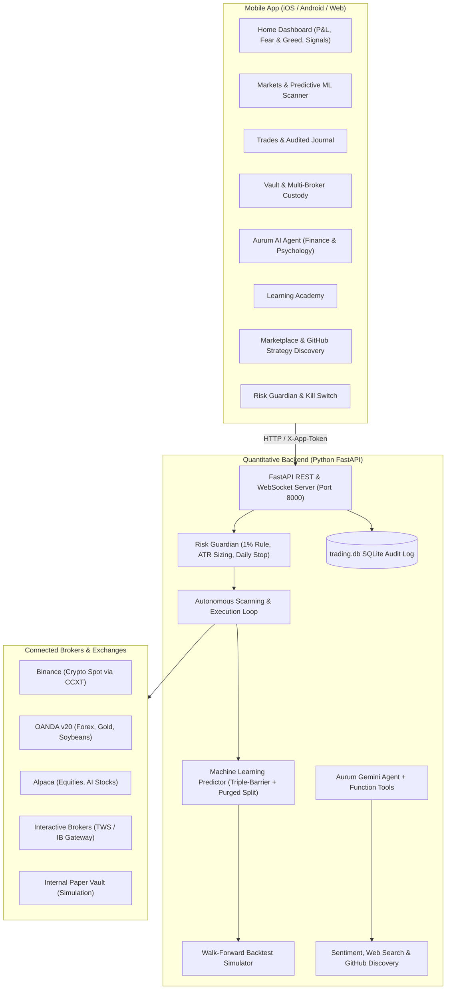

# AURUM — Autonomous Quant & AI Trading Platform

Aurum is a multi-asset trading and market prediction system featuring a high-end mobile interface (Expo / React Native) and an asynchronous quantitative backend (FastAPI / Scikit-Learn / CCXT / Gemini).

---

## 🏛 System Architecture



---

## 💎 Core Highlights

1. **Multi-Asset Coverage**:
   - **Crypto**: Bitcoin (`BTC/USDT`), Ethereum (`ETH/USDT`), Solana (`SOL/USDT`) via Binance public/private CCXT.
   - **Forex**: `EUR_USD` via OANDA.
   - **Commodities**: Gold (`XAU_USD`), Soybeans (`SOYBN_USD`) via OANDA.
   - **AI Equities**: NVIDIA (`NVDA`), Microsoft (`MSFT`) via Alpaca.

2. **Quant Predictor & The "89% Win Rate" Reality**:
   - **The Mathematical Truth**: In real financial markets, no static strategy wins 89% of trades unconditionally without taking catastrophic risk (e.g. risking \$100 to make \$1).
   - **Aurum's Calibrated Gate Approach**: Uses **triple-barrier labeling** (did the price hit the profit target before the stop loss within the holding horizon?) and **purged walk-forward validation**. Models output a *calibrated probability*. If you set the gate to 85%+, Aurum will wait patiently for rare, extremely high-probability alignment setups, maintaining strict positive expectancy.

3. **Risk Guardian (Institutional Capital Preservation)**:
   - **1% Rule**: Automatic position sizing = `(Equity × Risk%) ÷ |Entry − Stop|`.
   - **Daily Circuit Breaker**: Trading pauses if account drawdown exceeds your daily limit (e.g. 3%).
   - **Hardware/Server Stop Protection**: Stops placed on the exchange where supported.
   - **Emergency Kill Switch**: Instantly cancels scans and liquidates open positions.

4. **Aurum AI Agent (Finance & Human Psychology)**:
   - Powered by Google Gemini with live native tool calling (`get_market_overview`, `get_signal`, `run_backtest`, `search_web`, `get_sentiment`, `get_portfolio`).
   - Identifies cognitive biases: FOMO, loss aversion, revenge trading, and overconfidence.
   - AI Event Risk Veto: Scans breaking news to block trades ahead of sudden macro shocks.

5. **GitHub Strategy Discovery & Marketplace**:
   - Scans GitHub for popular, well-maintained algorithmic trading repositories.
   - Zero-trust sandbox: discovered plugins are marked "Pending" until you inspect and approve them.

---

## 🚀 Quick Start Guide

### 1. Launch the Backend
Double-click `run_backend.bat` or run:
```powershell
cd backend
python -m venv .venv
.\.venv\Scripts\activate
pip install -r requirements.txt
uvicorn app.main:app --host 0.0.0.0 --port 8000 --reload
```

### 2. Launch the Mobile App
Double-click `run_mobile.bat` or run:
```powershell
cd mobile
npx expo start
```
- Press `w` to open in your web browser.
- Or scan the QR code with the **Expo Go** app on your iPhone or Android phone to experience native haptics and vibrations!

### 3. Connecting Mobile to Backend
- Inside the mobile app, tap the **Settings** gear icon in the top right.
- If using an Android Emulator, use `http://10.0.2.2:8000`.
- If using a physical phone on Wi-Fi, enter your PC's Wi-Fi IP address (e.g. `http://192.168.1.50:8000`).
- Ensure the `App Token` matches the `APP_TOKEN` in `backend/.env`.

---

## 🔐 Broker & Live Trading Setup
Edit `backend/.env` to link real brokerage accounts:
```env
TRADING_MODE=live
BINANCE_API_KEY=your_key
BINANCE_API_SECRET=your_secret
OANDA_API_KEY=your_token
OANDA_ACCOUNT_ID=your_id
ALPACA_API_KEY=your_key
ALPACA_API_SECRET=your_secret
GEMINI_API_KEY=your_gemini_key
```
> [!IMPORTANT]
> When creating API keys on Binance or other exchanges, always **DISABLE WITHDRAWALS** and enable **IP RESTRICTIONS**.
